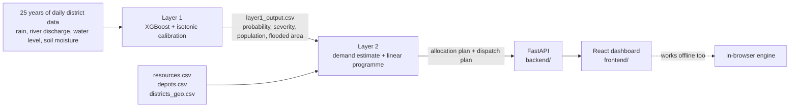

# AEGIS AI

A two-layer decision-support system for flood response in India. **Layer 1** forecasts district-level floods one day ahead. **Layer 2** turns those probabilities into a relief plan: how many rescue teams, boats, medical kits, food packets, litres of water and shelter slots each district gets, and from which depot.

Most flood-ML projects stop at the prediction. AEGIS asks the harder question: when several districts are at risk at once and stock is limited, who gets what, and how fast?


## How it fits together



The only thing the two layers share is one CSV, so either can be replaced without touching the other.

## What the dashboard does

- **Situation map** with an **aerial (satellite) view** and a schematic view. Flagged districts are sized by people affected, with depots and animated dispatch lines to the selected district. The boundary overlay follows the official Indian depiction, including all of Jammu & Kashmir and Ladakh. The satellite imagery carries no borders of its own, so the only boundary shown is that outline.
- **Allocation plan** per district and resource, with the guaranteed minimum marked and a plain-language reason for every allocation.
- **Dispatch table** (depot → district → resource → units → ETA) with filters and CSV export.
- **Optimised vs greedy** comparison and a response-time chart across pool sizes.
- **Forecast-error stress test**: reruns the plan 300 times with noisy probabilities and shows how far each district's coverage could move.
- **Two solvers**: a fast in-browser engine that works offline, and a **Server LP** mode that calls the FastAPI backend, which runs the exact HiGHS linear programme from the Layer 2 notebook.
- **Bring your own data**: drop in `layer1_output.csv`, `resources.csv`, `depots.csv`, `districts_geo.csv` or `layer2_dispatch_plan.csv`. A Layer 1 file with several dates adds a date picker.

## Results (30 May 2025 scenario, 9 of 30 districts flagged)

The pool covers 40.3% of estimated demand, so how it is shared matters.

| | Weighted greedy | Linear programme |
|---|---|---|
| Population covered | 40.3% | 40.3% |
| Critical districts below their minimum | 1 | **0** |
| Flooded districts with no service | 7 | **0** |
| Avg response time, paper's depot table | 42.4 h | **25.3 h** |
| Avg response time, this repo's placeholder depots | 43.8 h | **22.5 h** |

Response time differs between the last two rows only because the repo's depot locations are placeholders. Run the notebook with your own `depots.csv` for the numbers you cite.

Forecast model, 2025 held-out test year: **ROC-AUC 0.926**, but only 44.7% recall at 25.5% precision at the chosen threshold. The model ranks risk well; the operating point needs work before any operational use. The paper discusses this openly.

## Run it locally

```bash
# 1. backend (optional, enables Server LP mode)
cd backend
pip install -r requirements.txt
python test_solver.py            # reproduces the paper's pattern
uvicorn main:app --reload --port 8000

# 2. frontend
cd frontend
npm install
npm run dev                      # http://localhost:5173, /api is proxied to :8000
```

## Deploy

**Frontend on Vercel**
1. Push this repo to GitHub.
2. In Vercel, import the repo and set **Root Directory** to `frontend`. The Vite preset is detected automatically.
3. Deploy. The in-browser engine works with no backend.

**Backend on Render** (free tier, enables Server LP mode)
1. In Render, create a **Blueprint** from this repo. It reads `render.yaml`.
2. Copy the service URL, for example `https://aegis-api.onrender.com`.
3. In Vercel, add the environment variable `VITE_API_URL` with that URL and redeploy.
4. In Render, set `ALLOWED_ORIGINS` to your Vercel URL.

The free Render tier sleeps when idle, so the first Server LP request after a pause can take about 30 seconds. The page falls back to the browser engine if the server is unreachable.

## Repository layout

```
notebooks/   Layer 1 (forecasting) and Layer 2 (allocation) as run for the paper
backend/     aegis_lp.py  the LP, greedy baseline and metrics ported from the notebook
             main.py      FastAPI endpoints: /api/health, /api/demo, /api/solve
             test_solver.py
frontend/    React + Vite dashboard

```

## Assumptions and limitations

These are in the paper and in the UI, and they are the honest boundary of the project.

- **Flooded-area percentage is estimated**, not measured. Every "people affected" figure depends on it. Satellite or census data is the first thing to add.
- **Depot stock and four state-depot locations are placeholders.** NDRF battalion locations are approximate.
- **Travel time** is straight-line distance × 1.3 at 35 km/h, not real roads.
- **Calibration is thin above about 0.6** because the isotonic calibrator saw only two validation years with few floods.
- **One scenario is analysed in depth.** Multi-day rolling allocation and restocking are future work.


## Map data and credits

- Aerial imagery: Esri World Imagery (Esri, Maxar, Earthstar Geographics and the GIS User Community). Tiles load from the browser, so the aerial view needs an internet connection. If they cannot load, the app switches to the schematic map automatically. Check Esri's terms before any commercial use.
- India outline: DataMeet's `india-composite` boundary (github.com/datameet/maps), simplified to about 2 km in `frontend/src/lib/indiaBoundary.js`. Check that repository's licence before redistributing the data.

## Possible next steps

Cost-sensitive thresholds at a target recall, real exposure data, OpenStreetMap road routing with flood closures, rolling multi-day allocation, robust optimisation under forecast uncertainty, and a live river-gauge feed.


